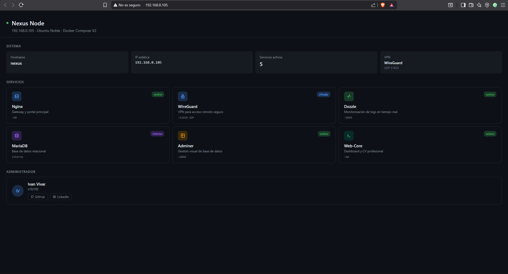

# 🚀 Nexus Node - Personal Infrastructure & IaC


[](https://www.linkedin.com/in/ivanvivartirado/)
[](https://github.com/ivanvivartirado)
[](https://ivanvivartirado.github.io)
[](https://github.com/ivanvivartirado/nexus-node/actions/workflows/ci.yml)

**Web del proyecto:** [ivanvivartirado.github.io/nexus-node](https://ivanvivartirado.github.io/nexus-node) (arquitectura, auditoría de seguridad y decisiones técnicas)

Este repositorio contiene la configuración y automatización de **Nexus Node**, una infraestructura personal diseñada bajo principios de **Infrastructure as Code (IaC)** y arquitectura de microservicios, optimizada para la seguridad y el acceso remoto cifrado.

## 📸 Vista del Dashboard



## 🏗️ Arquitectura del Sistema

El laboratorio corre sobre una máquina virtual con **Ubuntu Noble**, gestionada mediante **Docker Compose V2** y protegida por un túnel VPN persistente.

### Especificaciones de Red
- **Hostname:** `nexus`
- **IP Estática:** `192.168.0.105` (Configurada vía Netplan)
- **Acceso Externo:** Túnel VPN WireGuard (UDP 51820)

## 🌐 Stack de Servicios (Docker Compose)

Utilizo un modelo de arquitectura distribuida para garantizar la observabilidad y el servicio:

| Servicio | Descripción | Puerto |
|----------|-------------|--------|
| **Gateway (Nginx)** | Punto de entrada principal y reverse proxy | 80 |
| **Web-Core** | Dashboard de control y CV profesional | interno |
| **WireGuard** | Servidor VPN para acceso remoto seguro | 51820/UDP |
| **Dozzle** | Monitorización de logs en tiempo real (con login) | 8888 |
| **MariaDB** | Base de datos relacional | interno |
| **Adminer** | Gestión visual de base de datos | 8080 |
| **Uptime Kuma** | Monitorización de servicios y uptime | 3001 |
| **Fail2ban** | Protección contra fuerza bruta (contenedor) | — |

## 🛡️ Seguridad y Hardening

La infraestructura ha sido securizada siguiendo estándares de administración de sistemas:

- **Gestión de Identidades:** Migración de usuarios genéricos a cuenta administrativa dedicada `admin` con privilegios `sudo`.
- **Network Hardening:** Implementación de IP estática y DNS redundante (Google DNS) para evitar pérdida de conectividad.
- **Acceso Cifrado:** Uso de llaves SSH (`ed25519`) para autenticación sin contraseña y túnel VPN para administración remota.
- **Fail2ban:** Protección activa contra fuerza bruta desplegada como contenedor Docker.
- **Secretos fuera del repo:** las contraseñas viven en un `.env` que no se sube a Git (plantilla en `.env.example`).
- **Superficie mínima:** MariaDB no publica puerto; solo se llega a ella desde la red interna de Docker.
- **Dozzle con login:** tiene acceso al socket de Docker, que equivale a controlar la máquina (montarlo como `:ro` no limita la API), así que pide usuario y contraseña.
- **Revisión automática:** cada push pasa por GitHub Actions: valida el `docker-compose.yml`, revisa los scripts con ShellCheck y busca secretos con Gitleaks.

### Jails activas

| Jail | Protege | maxretry | bantime |
|------|---------|----------|---------|
| `sshd` | Puerto 22 / SSH | 5 intentos | 1 hora |

> 🔒 Las IPs de la LAN (`192.168.0.0/24`) y del túnel WireGuard (`10.13.13.0/24`) están en la lista blanca y nunca serán baneadas.

## 📊 Monitorización

**Uptime Kuma** proporciona visibilidad en tiempo real del estado de todos los servicios:

- ✅ Gateway
- ✅ Dozzle
- ✅ Adminer
- ✅ MariaDB
- ✅ WireGuard VPN

## 📁 Estructura del Proyecto

```bash
.
├── .github/workflows/ci.yml  # CI: Compose, ShellCheck y Gitleaks
├── ansible/                  # Playbooks de automatización
│   └── manage_users.yml
├── fail2ban/                 # Configuración de Fail2ban
│   └── data/
│       └── jail.d/
│           └── sshd.conf
├── nginx/
│   └── default.conf          # Configuración del reverse proxy
├── scripts/                  # Scripts de administración
│   └── crear_usuario.sh
├── web/
│   └── index.html            # Portal principal (Nexus Core)
├── wireguard/                # Configuración de túneles y llaves VPN
├── docs/                     # Web del proyecto (GitHub Pages)
├── docker-compose.yml        # Orquestación V2 de contenedores
├── .env.example              # Plantilla de variables (el .env real no se sube)
├── .gitignore                # Protección de secretos y configs locales
├── .gitleaks.toml            # Reglas del escáner de secretos
└── README.md                 # Documentación del proyecto
```

## 🚀 Cómo desplegar el entorno

### 1. Preparación del Sistema

```bash
# Cambiar el nombre del host a Nexus
sudo hostnamectl set-hostname nexus

# Configurar Netplan para IP estática (192.168.0.105)
sudo netplan apply
```

### 2. Despliegue de Infraestructura

```bash
# Entrar al directorio del proyecto
cd ~/mi-homelab

# Crear el .env con las contraseñas (no se sube a Git)
cp .env.example .env
nano .env

# Crear el usuario de Dozzle
mkdir -p data/dozzle
docker run --rm amir20/dozzle generate admin --password 'TU_CONTRASEÑA' --name Ivan > data/dozzle/users.yml

# Levantar todos los servicios en segundo plano
docker compose up -d
```

### 3. Acceso a los servicios

| Servicio | URL |
|----------|-----|
| Dashboard | http://192.168.0.105 |
| Uptime Kuma | http://192.168.0.105:3001 |
| Dozzle | http://192.168.0.105:8888 |
| Adminer | http://192.168.0.105:8080 |

---

*Nexus Node - Administrado por Ivan Vivar (x1b1t0)*
